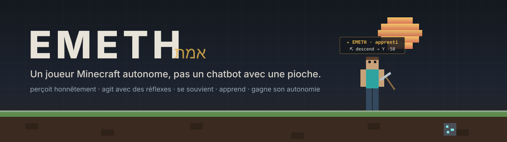
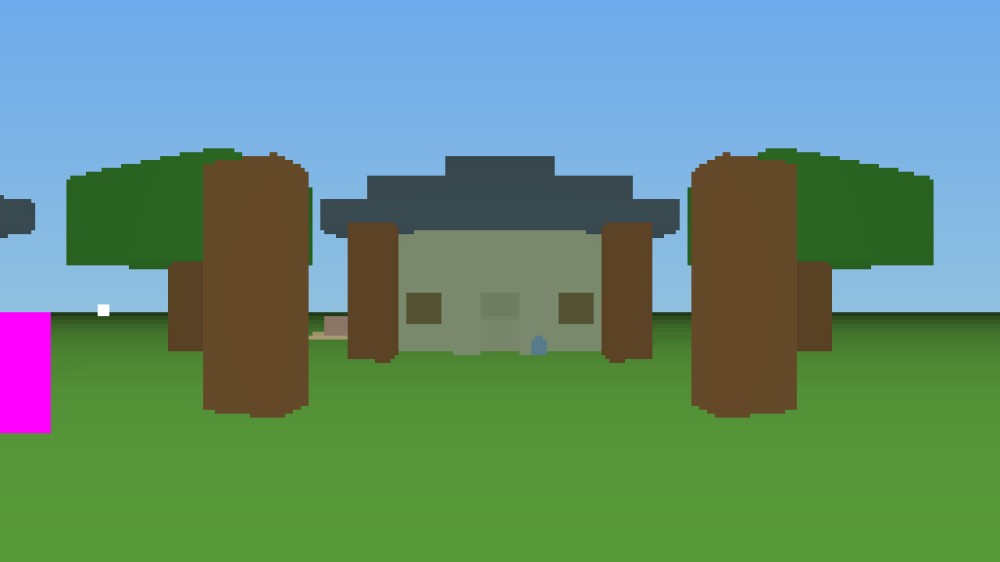
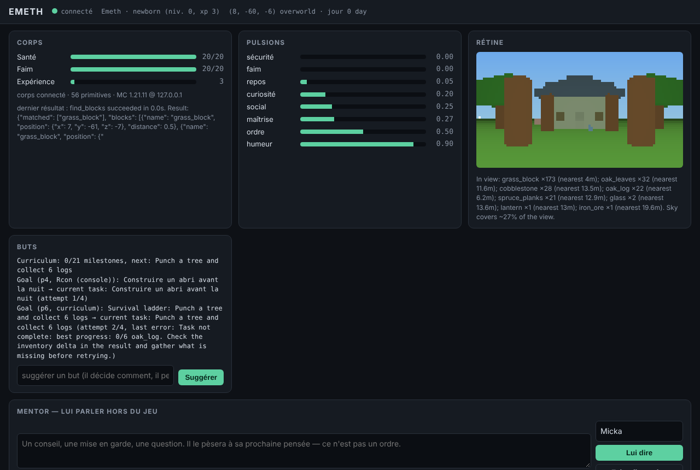
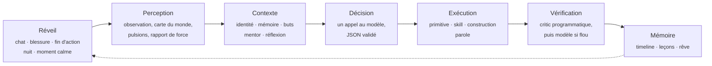
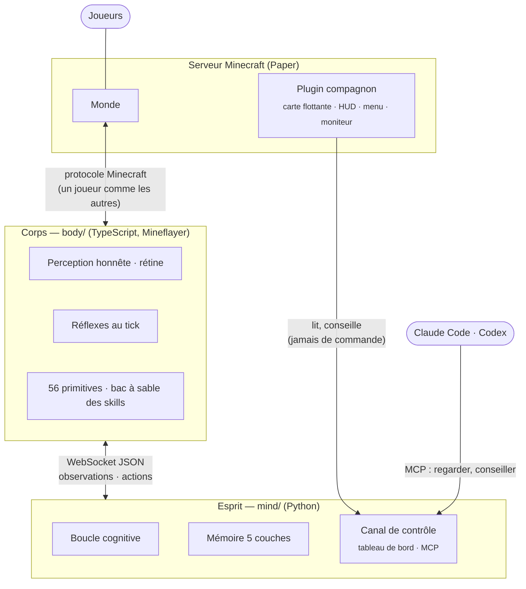

<div align="center">



**Un joueur Minecraft autonome qui perçoit, agit, se souvient et apprend. Pas un chatbot avec une pioche.**

[](LICENSE)
[](https://www.minecraft.net)
[](plugin/)
[](body/)
[](mind/)
[](https://github.com/Micka420-collab/Super_agent_mc/actions/workflows/ci.yml)

</div>

<br>

*Emeth* (אמת, « vérité ») est le mot écrit sur le front du golem pour lui donner vie. EMETH est un agent qui joue à
Minecraft comme une personne : il ne voit que ce que ses yeux voient, il agit avec un corps qui a des réflexes, il parle
quand il a quelque chose à dire, il se souvient pendant des semaines, il construit, il écrit ses propres compétences,
il rêve quand il dort, et il gagne son autonomie avec l'expérience.

Il ne triche jamais : pas de `/tp`, pas de `/give`, pas de vision à travers les murs. Les joueurs à côté de lui le voient
penser grâce au **plugin compagnon**, et peuvent le conseiller. Il reste seul à décider.

<table>
<tr>
<td width="50%" valign="top">

**Ce qu'il voit.** Sa rétine : une grille de rayons lancés depuis ses yeux, rendue en image sans GPU. La couleur dit le
bloc, la teinte dit la distance. Le petit carré magenta est un joueur.



</td>
<td width="50%" valign="top">

**Ce qu'il pense.** Le tableau de bord servi par l'esprit lui-même : corps, pulsions, rétine en direct, buts, timeline,
coûts des modèles, et une boîte pour lui parler en mentor.



</td>
</tr>
</table>

<sub>Captures réelles, prises pendant le test de bout en bout (`plugin/e2e/live_companion.py`) sur un serveur Paper 1.21.11.
La scène devant l'agent a été posée à la console pour la photo.</sub>

<br>

## Ce qu'il sait faire

| | |
|---|---|
| **Percevoir honnêtement** | Champ de vision et ligne de vue par lancer de rayons. Ce qu'il dit voir et ce qu'il montre (la rétine) viennent des mêmes rayons. Mode honnête : ce qui est derrière un mur n'existe pas pour lui. |
| **Agir avec des réflexes** | Les réflexes tournent à chaque tick, sans modèle de langage : fuir la lave, remonter respirer, s'écarter d'un creeper, se défendre, manger. Ils interrompent l'action en cours et préviennent l'esprit. |
| **Lire le rapport de force** | Monstres, armure, arme, bouclier, vie et nuit donnent un danger de 0 à 1 et un conseil : combattre, reculer ou fuir. Il fuit une foule même en pleine santé. Un creeper n'est jamais un combat. |
| **Obtenir ce qu'il lui faut** | `get diamond_pickaxe` devient un plan prouvé (miner, fabriquer, fondre, chasser), recalculé après chaque étape à partir de son inventaire réel. |
| **Miner comme un joueur** | Il sait où vivent les minerais (diamant à Y −58, fer à 16…). Il descend en escalier en vérifiant chaque marche (lave, eau, trou, gravier, chunk non chargé), puis creuse des galeries. |
| **Construire** | Un architecte décrit le bâtiment dans un petit langage paramétrique. Le corps vérifie que chaque bloc aura un appui avant de le poser, et récolte lui-même les matériaux manquants. |
| **Apprendre** | Pour une tâche en plusieurs étapes, il écrit du JavaScript. Le code est analysé, puis exécuté dans un bac à sable à trois couches, et gardé s'il réussit. Il retient aussi ce qu'il voit les joueurs construire. |
| **Se souvenir** | Cinq couches de mémoire : épisodes, wiki markdown, carte des lieux, compétences, personnes. Quand il dort, il rêve : sa journée devient leçons, lieux et récit. |
| **Se remettre en question** | Quand il refait la même erreur, il le remarque. Il cherche une autre méthode, demande de l'aide, ou abandonne avec une raison. |
| **Survivre sans modèle** | Si aucun modèle de langage ne répond, l'instinct prend le relais : manger, s'abriter, dormir, continuer l'échelle de survie. |
| **Grandir** | Six niveaux d'autonomie, du nouveau-né à l'éveillé, débloqués par l'expérience. Chaque niveau change ce qu'il peut décider seul. |

<br>

## Dans le jeu : le plugin compagnon

Un plugin **Paper** donne aux joueurs une fenêtre dans sa tête, sans rien installer côté client
([`plugin/`](plugin), [ADR-0007](docs/adr/0007-plugin-compagnon-paper.md)).

| | |
|---|---|
| **Carte flottante** | Au-dessus de l'agent : ce qu'il fait, sa dernière pensée, le rapport de force. Elle est cachée à l'agent lui-même, qui ne la perçoit jamais. |
| **Affichage tête haute** | `/emeth hud` : une barre de boss pour le but et l'échelle de survie, une barre d'action pour sa vie, sa faim et le danger, et un tableau latéral pour son humeur, ses pulsions et ses pensées. |
| **« Dans la tête d'Emeth »** | `/emeth` : un menu rafraîchi en direct avec son état, ses sept pulsions, ce qu'il pense et fait, sa réflexion, ses objectifs, son journal et le moniteur. |
| **Moniteur rétine** | `/emeth monitor` : une carte, ou un mur de deux cartes, qui montre ce que voient ses yeux. |
| **Conseiller** | Clic sur la plume, puis on écrit dans le chat : le conseil arrive dans sa prochaine pensée, hors du chat public. Quand il tourne en rond, les mentors reçoivent une ligne cliquable pour lui souffler une autre approche. |

Le plugin est vérifié de bout en bout sur un vrai serveur. Un second client Minecraft joue l'humain et contrôle ce qu'il
reçoit : barre de boss, tableau latéral, menu, pixels de la carte, réponse de l'agent. Il vérifie aussi, depuis les sens
de l'agent, que la carte flottante lui reste invisible.

<br>

## Comment il pense



Chaque réveil donne **une** décision : une action, et une parole si elle est utile. Le silence est une réponse valide.
Les réflexes, l'approvisionnement, la vérification des constructions et l'instinct sont déterministes. Le modèle de
langage choisit, il ne fait pas tout.

<br>

## Architecture



Le corps et l'esprit sont deux processus. On peut redémarrer l'un sans l'autre, les mettre sur deux machines, ou changer
de modèle de langage sans que l'agent oublie qui il est : son **âme** s'exporte en markdown et en JSON.
Détails dans [`docs/ARCHITECTURE.md`](docs/ARCHITECTURE.md), décisions dans [`docs/adr/`](docs/adr).

<br>

## Démarrage rapide

**Il vous faut :** Node 20+, Python 3.11+, Java 21, un serveur Minecraft 1.21.11 en `online-mode=false` (fourni en
Docker) et une clé de modèle de langage : Anthropic, OpenAI, OpenRouter, ou Ollama en local.

```bash
# 1. le serveur (Paper 1.21.11) et le plugin compagnon
cd plugin && ./gradlew build && mkdir -p ../server/data/plugins && cp build/libs/emeth-companion-*.jar ../server/data/plugins/
cd ../server && docker compose up -d

# 2. le corps
cd ../body && npm install && npm run build
MC_HOST=127.0.0.1 MC_PORT=25565 MC_USERNAME=Emeth BRIDGE_TOKEN=change-me npm start

# 3. l'esprit (autre terminal)
cd mind && python -m venv .venv && . .venv/bin/activate && pip install -e ".[dev]"
export ANTHROPIC_API_KEY=...  EMETH_BRIDGE_TOKEN=change-me
emeth doctor && emeth run
```

Rejoignez le serveur, puis tapez `/emeth` ou `/emeth hud`. Le guide complet de la première session est
[`docs/FIRST_RUN.md`](docs/FIRST_RUN.md). La configuration se règle dans `mind/providers.example.yaml` (modèles par
niveau `smart`/`fast`/`code`/`vision`), `mind/persona.example.yaml` (caractère, propriétaire) et `.env.example`.

<br>

## Lui parler

| Où | Comment |
|---|---|
| **Dans le chat** | Dites son nom (« Emeth, viens voir ma maison ») ou chuchotez-lui (`/msg Emeth …`). Le propriétaire de la persona compte plus. |
| **Avec le plugin** | `/emeth tell <conseil>`, `/emeth goal <but>`, ou la plume du menu. |
| **Depuis Claude Code ou Codex** | `claude mcp add emeth -- emeth mcp`. Les outils `emeth_look`, `emeth_status`, `emeth_tell` et sept autres permettent de voir par ses yeux, de lire sa mémoire et de le conseiller. |
| **Dans un navigateur** | `http://127.0.0.1:8766/?token=$(cat mind/data/control.token)` ouvre le tableau de bord. |

Partout, la règle est la même : vous êtes son mentor, pas sa manette ([ADR-0006](docs/adr/0006-canal-de-controle-et-facade-mcp.md)).

<br>

## Sûr par construction

- **Il joue à la loyale.** Le corps ne lance aucune commande serveur et ne lit pas les blocs non chargés. Les réflexes
  n'attaquent jamais un joueur.
- **Le code qu'il écrit est enfermé.** Une analyse statique passe d'abord (acorn), puis le code tourne dans un worker
  thread, puis dans une `vm` sans génération de code. Le budget de temps est dur : même une boucle infinie est tuée.
- **Ses canaux sont protégés.** Le bridge et le canal de contrôle exigent un jeton. Le canal de contrôle n'écoute que
  sur localhost, et le plugin refuse un hôte distant sauf choix explicite. Les jetons ne sont jamais journalisés.
- **Le conseil reste un conseil.** Rien de l'extérieur ne commande son corps : un conseil arrive dans sa pensée suivante
  et il peut le refuser. Un délai entre deux conseils protège son attention et votre facture.
- **Sa mémoire ne se laisse pas piéger.** Le chat est traité comme une donnée. L'historique importé est marqué « non
  fiable ». Ses valeurs cœur ne se modifient pas par le chat.

<br>

## État du projet

| Partie | Tests | Ce qui est vérifié |
|---|---|---|
| Corps | 103 unitaires + 10 bout en bout | sur un vrai serveur Minecraft JS : déplacement, minage, escalier relevé et galerie, construction d'un cottage de 71 blocs, approvisionnement, skill en bac à sable, bridge authentifié |
| Esprit | 63 | routeur de modèles, mémoire, cognition, réflexion, architecte, boucle complète contre un corps simulé, canal de contrôle et MCP |
| Plugin | 33 unitaires + 28 vérifications bout en bout | sur Paper 1.21.11, avec le vrai corps, le vrai esprit et un second client qui joue l'humain |

**Ce qui reste à prouver :** une longue session sur un vrai serveur avec un vrai modèle de langage. C'est l'étape M1 de la
[feuille de route](docs/ROADMAP.md). Il faudra y régler le coût par heure, la fréquence des pensées et les seuils de
fuite. La voix, le récap vidéo, l'imagination et la société de plusieurs agents sont conçus mais pas encore codés
([`docs/INNOVATIONS.md`](docs/INNOVATIONS.md)).

<br>

## Développer

```bash
cd body   && npm test && npm run test:e2e && npm run typecheck          # corps
cd mind   && pytest && ruff check src tests && mypy src/emeth          # esprit
cd plugin && ./gradlew build                                           # plugin (compile + JUnit)
cd mind   && python ../plugin/e2e/live_companion.py                    # plugin de bout en bout sur Paper (≈ 2 min)
cd body   && npx tsx src/tools/gen-fixtures.ts ../protocol/fixtures    # après un changement du protocole corps ↔ esprit
cd mind   && python scripts/gen_control_fixtures.py                    # après un changement du statut lu par le plugin
```

| Dossier | Contenu |
|---|---|
| [`body/`](body) | Le corps : perception, rétine, réflexes, 56 primitives, planificateur d'approvisionnement, bac à sable des skills, bridge |
| [`mind/`](mind) | L'esprit : routeur de modèles, mémoire, boucle cognitive, réflexion, architecte, identité, canal de contrôle, MCP, tableau de bord |
| [`plugin/`](plugin) | Le plugin compagnon Paper, et son test de bout en bout |
| [`protocol/`](protocol) | Les fixtures partagées, validées par les trois suites de tests |
| [`skills/`](skills) | La bibliothèque de compétences, versionnée et enrichie en jouant |
| [`server/`](server) | Le serveur Paper de test en Docker |
| [`docs/`](docs) | Architecture, décisions (ADR), innovations, feuille de route, synthèse de l'état de l'art |

Les agents de code (Claude Code, Codex) suivent [`CLAUDE.md`](CLAUDE.md).

<br>

## Licence

[MIT](LICENSE). Les projets étudiés sont crédités dans [`docs/RESEARCH.md`](docs/RESEARCH.md). Rien n'a été copié de
ChatClef (AGPL) : les idées d'AltoClef (MIT) ont été réimplémentées. L'interface en jeu s'inspire d'AgentCraft
(blendi-remade/agentcraft, MIT), sans en reprendre le code. EMETH n'est affilié ni à Mojang, ni à Microsoft, ni à Anthropic.

<div align="center">
<br>
<sub>אמת — construit avec Claude.</sub>
</div>
